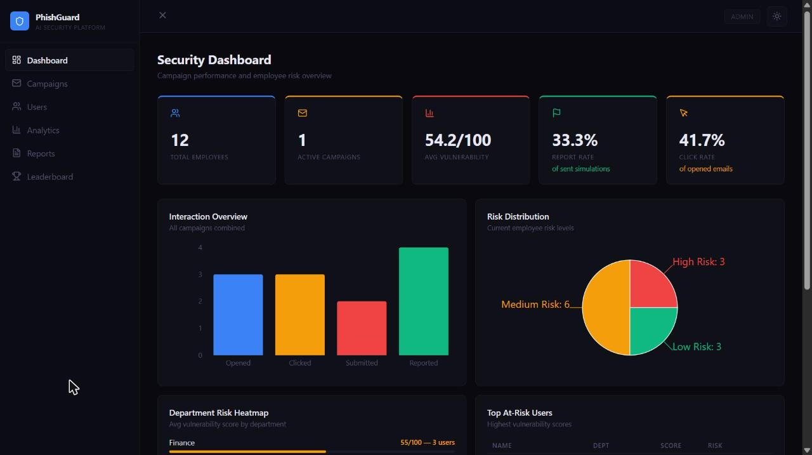
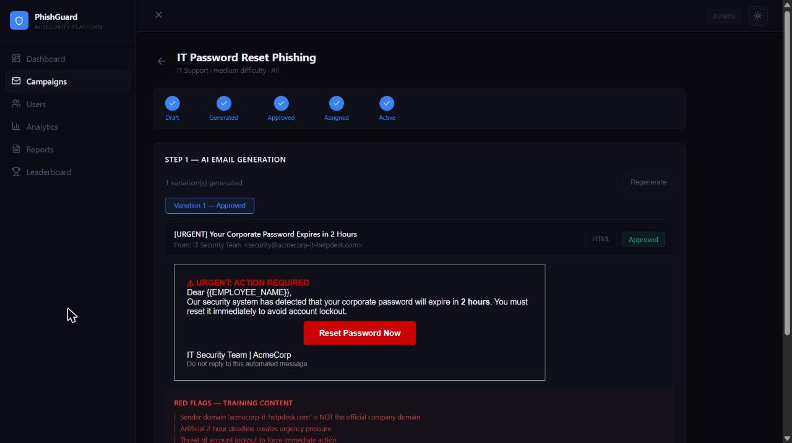
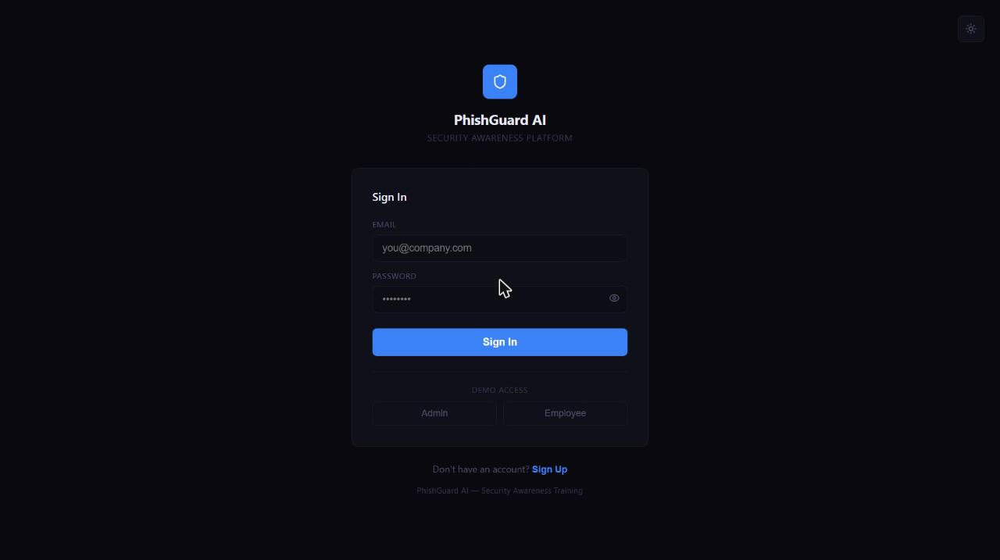

# PhishGuard AI — AI-Driven Phishing Simulation Platform
> An AI-driven phishing simulation and security awareness training platform that runs realistic, safe phishing campaigns, tracks how users respond, and delivers just-in-time training.

---

## 📸 Screenshots

**Admin dashboard** — campaign performance, report/click rates and employee risk distribution



**Campaign detail** — AI-generated phishing email with the red-flag training content shown to employees



**Login**



---

## ⚠️ Ethical Use Statement

This platform is designed **exclusively** for authorized security awareness training. All phishing pages are simulations only. **Real passwords are never stored.** Only the event of a submission attempt is logged for educational purposes. All AI-generated content is filtered through safety guardrails to prevent offensive or harmful material.

---

## 🏗 Architecture Overview

```
┌─────────────────────────────────────────────────────────┐
│                    React.js Frontend                      │
│    Admin Dashboard  |  Employee Dashboard  |  Training   │
└──────────────────────────┬──────────────────────────────┘
                           │ HTTP REST API
┌──────────────────────────▼──────────────────────────────┐
│                   Flask Backend (Python)                  │
│  Auth & RBAC  │  Campaign Mgmt  │  AI Generator          │
│  Tracking     │  Score Engine   │  Gamification          │
└──────────────┬────────────────────────────┬─────────────┘
               │                            │
┌──────────────▼──────┐      ┌─────────────▼─────────────┐
│  SQLite / PostgreSQL │      │  Ollama (Local LLM)        │
│  (Database)          │      │  llama3.2 via LangChain    │
└─────────────────────┘      └───────────────────────────┘
```

---

## 🚀 Quick Start

### Prerequisites

| Tool | Version | Install |
|------|---------|---------|
| Python | 3.11+ | python.org |
| Node.js | 18+ | nodejs.org |
| Git | Any | git-scm.com |
| Ollama (optional) | Latest | ollama.ai |

---

### Step 1 — Clone / Open Project

```bash
git clone https://github.com/alaa-abooun/PhishGuard.git
cd PhishGuard
```

---

### Step 2 — Backend Setup

```bash
cd backend

# Create virtual environment
python -m venv venv

# Activate (Windows)
venv\Scripts\activate

# Install dependencies
pip install -r requirements.txt

# Copy environment config
copy .env.example .env

# Run (creates DB + seeds sample data automatically)
python run.py
```

The backend starts on **http://localhost:5000**

On first run it:
- Creates all database tables
- Seeds sample admin + 12 employee accounts
- Seeds 3 sample campaigns with email variations
- Seeds 8 badge types
- Creates sample interaction history

**Demo Credentials:**
| Role | Email | Password |
|------|-------|----------|
| Admin | admin@acmecorp.com | Admin@1234 |
| Employee | yousef@acmecorp.com | Employee@1234 |
| Employee | lina@acmecorp.com | Employee@1234 |

---

### Step 3 — Frontend Setup

```bash
# Open new terminal
cd frontend

npm install
npm start
```

The frontend starts on **http://localhost:3000**

---

### Step 4 (Optional) — Ollama AI Setup

For real AI-generated phishing emails:

```bash
# Install Ollama from https://ollama.ai
ollama pull llama3.2
ollama serve
```

Without Ollama, the system uses high-quality built-in template variations.

---

## 📁 Project Structure

```
PhishGuard/
├── backend/
│   ├── app/
│   │   ├── models/          # SQLAlchemy database models
│   │   │   ├── user.py
│   │   │   ├── campaign.py
│   │   │   ├── interaction.py
│   │   │   ├── gamification.py
│   │   │   └── prompt.py
│   │   ├── routes/          # Flask API blueprints
│   │   │   ├── auth.py
│   │   │   ├── campaigns.py
│   │   │   ├── ai_generator.py
│   │   │   ├── tracking.py
│   │   │   ├── analytics.py
│   │   │   ├── users.py
│   │   │   ├── gamification.py
│   │   │   └── reports.py
│   │   └── services/        # Business logic
│   │       ├── ai_service.py        # LLM integration + safety
│   │       ├── email_service.py     # Simulated email sending
│   │       ├── score_engine.py      # Vulnerability Score calculation
│   │       ├── adaptive_engine.py   # Difficulty adaptation
│   │       └── gamification_service.py
│   ├── config.py
│   ├── run.py               # Entry point + DB seeding
│   └── requirements.txt
│
├── frontend/
│   └── src/
│       ├── pages/
│       │   ├── Login.jsx
│       │   ├── PhishingLanding.jsx      # Simulated phishing page
│       │   ├── TrainingPage.jsx         # Just-in-time training
│       │   ├── admin/
│       │   │   ├── AdminDashboard.jsx
│       │   │   ├── CampaignList.jsx
│       │   │   ├── CreateCampaign.jsx
│       │   │   ├── CampaignDetail.jsx   # AI generate + approve
│       │   │   ├── UsersManagement.jsx
│       │   │   ├── Analytics.jsx
│       │   │   ├── Reports.jsx
│       │   │   └── Leaderboard.jsx
│       │   └── employee/
│       │       ├── EmployeeDashboard.jsx
│       │       ├── SimulationInbox.jsx
│       │       ├── BadgesPage.jsx
│       │       └── EmployeeLeaderboard.jsx
│       ├── components/
│       │   ├── Layout.jsx
│       │   ├── StatCard.jsx
│       │   └── ScoreGauge.jsx
│       ├── context/
│       │   └── AuthContext.jsx
│       └── services/
│           └── api.js
```

---

## 🔌 API Endpoints

### Authentication
| Method | Endpoint | Description |
|--------|----------|-------------|
| POST | /api/auth/login | Login (returns JWT) |
| POST | /api/auth/refresh | Refresh access token |
| GET | /api/auth/me | Get current user |
| POST | /api/auth/logout | Logout |

### Campaigns (Admin only)
| Method | Endpoint | Description |
|--------|----------|-------------|
| GET | /api/campaigns/ | List all campaigns |
| POST | /api/campaigns/ | Create campaign |
| GET | /api/campaigns/:id | Get campaign details |
| POST | /api/campaigns/:id/activate | Activate & send emails |
| POST | /api/campaigns/:id/assign | Assign users |
| POST | /api/campaigns/:id/emails/:eid/approve | Approve AI email |

### AI Generation (Admin only)
| Method | Endpoint | Description |
|--------|----------|-------------|
| POST | /api/ai/generate/:campaign_id | Generate email variations |
| GET | /api/ai/emails/:campaign_id | List generated emails |
| GET | /api/ai/prompt-logs/:campaign_id | View AI audit logs |

### Tracking (No auth — accessed via email links)
| Method | Endpoint | Description |
|--------|----------|-------------|
| GET | /api/track/open/:token | Track email open (pixel) |
| GET | /api/track/click/:token | Track link click → redirect |
| GET | /api/track/landing/:token | Get landing page data |
| POST | /api/track/submit/:token | Record fake credential attempt |
| POST | /api/track/report/:token | Record phishing report |

### Analytics
| Method | Endpoint | Description |
|--------|----------|-------------|
| GET | /api/analytics/overview | Admin dashboard data |
| GET | /api/analytics/campaigns/:id/stats | Per-campaign stats |
| GET | /api/analytics/risk-heatmap | Department risk heatmap |
| GET | /api/analytics/score-trend | Score history trend |
| GET | /api/analytics/my-stats | Employee self-service stats |

---

## 🧠 Vulnerability Score Engine

```
Starting Score: 50

Action                      Score Delta
─────────────────────────────────────────
Report phishing             -10
Fast report (< 5 min)       -5 (bonus)
Streak bonus (3+ reports)   -3 (bonus)
Open email only              0
Ignore email                +5
Click phishing link         +15
Submit fake credentials     +25

Score range: 0–100 (clamped)
```

### Risk Level Mapping
| Score Range | Risk Level | Difficulty Assigned |
|-------------|-----------|---------------------|
| 0 – 30 | 🔴 High Risk | Hard (convincing) |
| 31 – 70 | 🟡 Medium Risk | Medium |
| 71 – 100 | 🟢 Low Risk | Easy (obvious) |

---

## 🎮 Gamification Points

| Action | Points |
|--------|--------|
| Report phishing | +50 |
| Fast report bonus | +25 |
| Earn a new badge | (badge milestone) |

---

## 🔒 Security Design

- All passwords stored as bcrypt hashes (never plaintext)
- JWT tokens with 8-hour expiry
- RBAC enforced server-side on every endpoint
- Fake credential form: values are explicitly ignored server-side
- AI safety guardrails block NSFW/harmful keywords
- Tracking tokens are cryptographically random (secrets.token_urlsafe)
- PII never sent to external AI APIs (local Ollama only)

---

## 🧪 Test Cases Summary

Black-box test cases:

| Test ID | Description | Expected | Status |
|---------|-------------|----------|--------|
| TC-01 | Valid admin login | JWT + redirect to admin dashboard | ✅ Pass |
| TC-02 | Invalid password | 401 error message | ✅ Pass |
| TC-03 | Employee accessing /admin | 403 Forbidden | ✅ Pass |
| TC-04 | Generate AI emails | 3 unique variations returned | ✅ Pass |
| TC-05 | Approve email | Campaign status → pending_approval | ✅ Pass |
| TC-06 | Activate campaign (no users) | Error: assign users first | ✅ Pass |
| TC-07 | Submit fake credentials | Score +25, redirect to training | ✅ Pass |
| TC-08 | Report phishing | Score -10, points +50 | ✅ Pass |
| TC-09 | Fast report (<5min) | Score -15 total | ✅ Pass |
| TC-10 | Export CSV | Valid CSV file download | ✅ Pass |

---

## 🔧 Technologies Used

| Layer | Technology |
|-------|-----------|
| Frontend | React.js 18, React Router 6, Recharts |
| Backend | Python 3.11, Flask 3.0, SQLAlchemy |
| Auth | Flask-JWT-Extended (JWT Bearer tokens) |
| Database | SQLite (dev) / PostgreSQL (production) |
| AI/LLM | Ollama (local), LangChain, llama3.2 |
| Email | Flask-Mail (SMTP / mock mode) |
| Charts | Recharts (React charting library) |
| Styling | Pure CSS-in-JS (no external CSS frameworks) |
